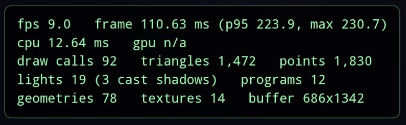
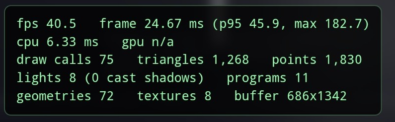

# Performance: beacon lights and shadows removed

The change is pull request #7 (commit 341213a). This page records how it was measured, so the comparison can be repeated.

**Before:** `dev` at a8de17a. **After:** commit 341213a (now in `dev`). I served both side by side from the same laptop (`npm run dev`, ports 5201 and 5202), opened each with `?perf`, and read the green readout after about 20 seconds without touching anything.

**Devices**
- Poco X3 NFC (Android 12), Chrome, over Wi-Fi from the laptop. Buffer 686x1342. One reading per version.
- iPhone 16 Pro Max, Safari. One reading per version, in the tour view.
- Laptop: Intel i7-14700HX, Windows 11, 1280x720 window, pixel ratio 1, default view. Three readings per version, alternating before and after.
  - Intel UHD (integrated), Chrome 155. This one has six readings per version, because two of my runs ended up on this chip.
  - RTX 4060 (discrete), Edge 156.
  - Software rendering (no graphics chip), Chrome 155.

**Results**

| Device | Before | After |
|---|---|---|
| Poco X3 NFC | 9.0 fps (111 ms per frame) | 40.5 fps (25 ms per frame) |
| Intel UHD | 97 fps (GPU 6.4 ms) | 142 fps (GPU 3.4 ms) |
| Software rendering | 2.2 fps (455 ms) | 3.8 fps (262 ms) |
| RTX 4060 | 240 fps (GPU 0.61 ms) | 240 fps (GPU 0.46 ms) |
| iPhone 16 Pro Max | 58.5 fps | 60 fps (at the limit) |

Lights 19 to 8 and shadow casters 3 to 0. Draw calls 116 to 99 on the laptop and 92 to 75 on the Poco.

Readout, Poco X3 NFC, before:



Readout, Poco X3 NFC, after:



**Reproduce**

```bash
git worktree add --detach ../xr-before a8de17a
cd ../xr-before && npm install && npm run dev -- --port 5201 --host
```

```bash
npm install && npm run dev -- --port 5202 --host    # in a checkout of dev
```

Open `http://localhost:5201/?perf` (before) and `http://localhost:5202/?perf` (after) and compare the green readout. On a phone, use the laptop's address instead of `localhost`.

**Limits:** the Poco readings were taken once each. The before reading was on the landing page and the after reading was on the mood-picker screen, which blurs the scene, so the real gain may be a little larger. The iPhone readings were in the tour view, so I only use the frame rate. I measured only the default view.
