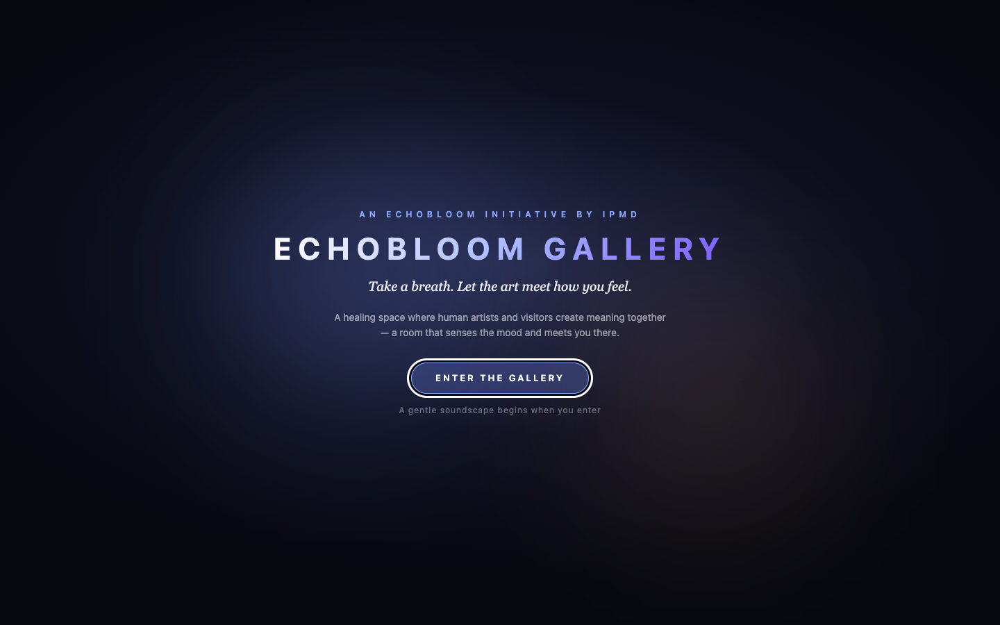
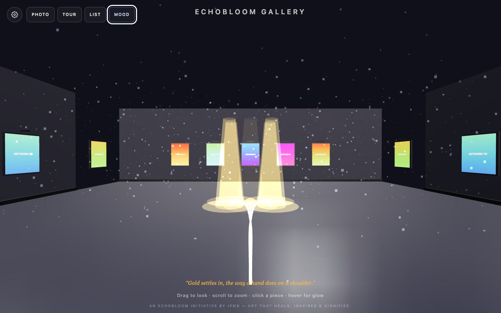
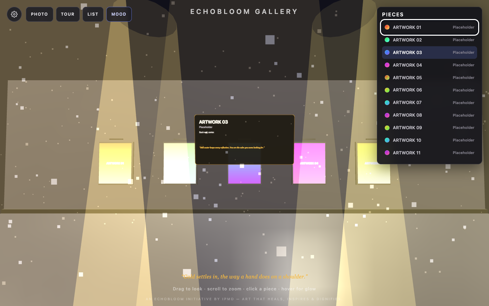
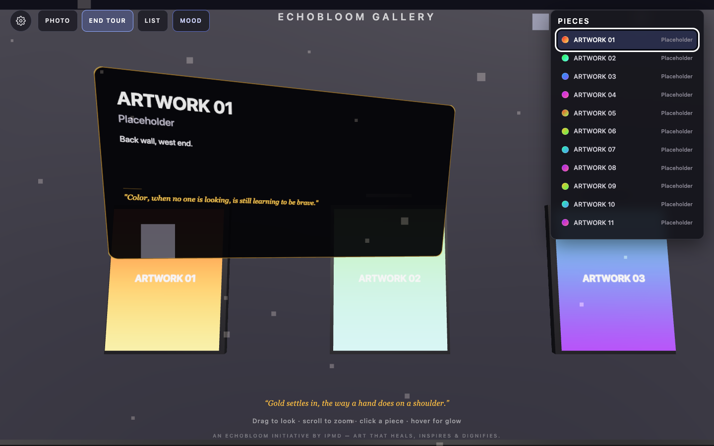
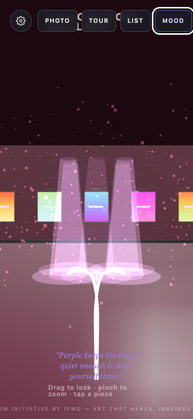
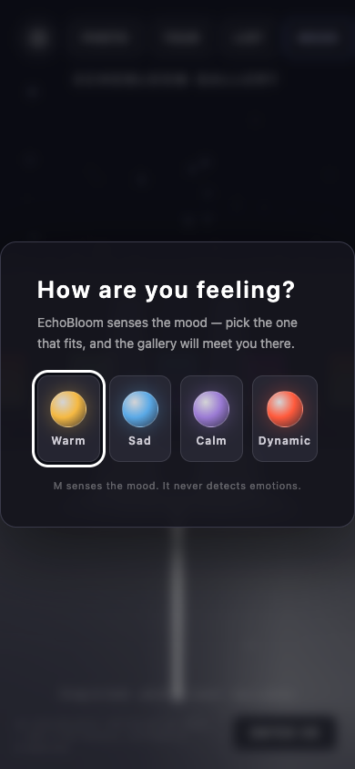
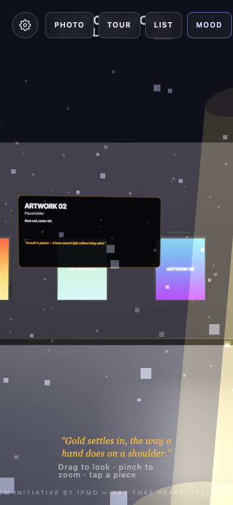
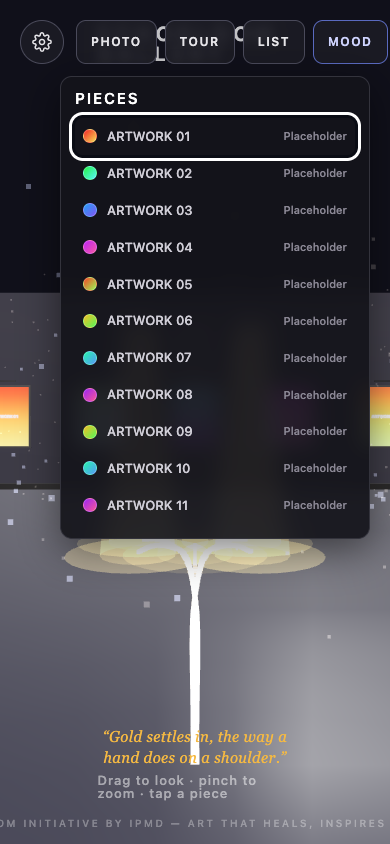

# v1 end-to-end check — public URL

**Week of Nov 16–22 · Jason Fang · checked 19 Nov 2026**

- **URL:** <https://ipmdgit.github.io/xr-gallery/> (HTTP 200, GitHub Pages)
- **Build under test:** branch `gh-pages`, commit `1ef2f53` *"Publish v1 build to GitHub Pages"* (13 Nov),
  built from `deploy/v1-preview` (dev + the ENTER VR gate)
- **Checked at:** 1440×900 desktop, 390×844 phone, 360×640 small phone
- **Outcome:** the v1 slice loads end to end. Every control works on desktop and on a phone.
  One thing looks broken — the phone header — and one thing is missing by design — the art itself.

---

## 1. What loads

**Verdict: the slice works.** Landing → enter → mood → room → piece → info card → tour → photo →
settings, in that order, with no dead ends and no JavaScript errors.

| # | Step | Desktop | Phone |
|---|---|---|---|
| 1 | Landing screen, tagline, ENTER THE GALLERY | ✅ | ✅ (390×844, content fits) |
| 2 | Enter: landing fades, mood dialog opens | ✅ | ✅ |
| 3 | Mood pick: room re-tints, poetic line appears | ✅ Warm applied | ✅ Calm applied |
| 4 | Room renders, mood saved for the next visit | ✅ | ✅ |
| 5 | LIST: 11 pieces listed, active row highlighted | ✅ | ✅ panel scrolls, closes on pick |
| 6 | Pick a piece: camera flies in, info card appears | ✅ | ✅ |
| 7 | Tap a piece in the 3D room (no LIST) | n/a | ✅ tap at the artwork opens its card |
| 8 | TOUR: label becomes END TOUR, ends cleanly | ✅ | not exercised this pass (see §4) |
| 9 | PHOTO: downloads `echosphere-<ms>.png` | ✅ 1440×900 | ⚠️ 682×1477 — see 3.3 |
| 10 | Settings: gear opens the panel with its three toggles | ✅ | ✅ |
| 11 | ENTER VR hidden on a device that cannot do WebXR | ✅ correct | ✅ correct |
| 12 | Console: no exceptions, no failed requests except favicon | ⚠️ 1 deprecation warning | ⚠️ same |

**Payload** (all 200, correct content types):

| Asset | Size |
|---|---|
| `index.html` | 664 B |
| `assets/index-DBNtTHnY.js` | 673,674 B (173,619 B gzip) |
| `assets/index-c060Z6g2.css` | 9,551 B |
| `artwork/core.glb` | 299,100 B |

Base path is right: every asset resolves under `/xr-gallery/`, so Pages serves it correctly.

---

## 2. What breaks

Ordered by what a visitor hits first.

### 2.1 The phone header is behind the toolbar (highest visible severity)

On a 390 px phone the title sits **under** the PHOTO / TOUR / LIST / MOOD row, so all you see of
"ECHOBLOOM GALLERY" is a letter or two peeking through the gaps between buttons. The footer runs off
both edges of the screen.

Measured at 390×844:

| Element | Box | Problem |
|---|---|---|
| `#title` | x 98–293, **y 24–64** | the toolbar is x 76–388, **y 20–64** — complete overlap |
| `#footer` | **x −96 → 485** | 581 px wide and centred on a 390 px screen; both ends clipped |
| `#hint` | y 761–800, 2 lines | crowds `#mood-line` (y 726–768) by ~7 px |

Cause: the shipped CSS has no `max-width: 640px` rule for `#title` / `#hint` / `#footer`. The title is
`font 20px, letter-spacing 6px` with `white-space: normal`, so it wraps onto two lines and the toolbar
lands on top of it; the footer is `nowrap` at 581 px and simply overflows.

**This is already written.** `origin/fix/phone-header-layout` (`e8be6bf`, 16 Nov) adds exactly that
media query. I built that branch and re-measured at 390: title drops to `y 80–94` on one line under the
toolbar, hint becomes one line at `y 756–768`, footer wraps into three lines at `x 16–240`. It works —
it is just not merged, so it is not on the live URL.

### 2.2 The info card is unreadable on a phone

Tap a piece on a phone and the card opens correctly — but the text is 4–8 px tall.

The card is a 2.9 m plane with a 2048×1024 texture. After the fly-in it is about 250 px wide on a 390 px
screen, so the 92 px title renders at ~8 px and the 42 px description at ~5 px. At 1440 it is ~310 px
wide and the description is ~7 px — small, but legible. On a phone it is not.

### 2.3 PHOTO saves the viewport, not the screen, on a phone

Desktop saves 1440×900. On a 390×844 phone at DPR 3 it saves **682×1477** — the pixel ratio is capped at
1.75 for performance, so the file is under half the phone's real 1170×2532. Fine for a quick share,
soft for anything printed or sent to Min.
`origin/fix/photo-full-resolution` (`44725c2`) targets this and is also unmerged.

### 2.4 The room's light columns hide the art

Eleven beacons (a 3.1 m additive cylinder each, plus a 90-point ribbon and a floor pool) line up on the
entry axis. Additive blending sums them, so from the front door the centre of the room blows out to
white and the pieces behind it disappear into the glow. It reads as a light fountain rather than as
lighting on art, and on a phone the cones take most of the screen.

Nobody has filed this, and it is the item most likely to cost us the hall — Min is judging the art, and
on first entry the art is the thing that is hardest to see.

### 2.5 The content is still placeholders

`src/data/artworks.json` holds 11 items, `placeholder-1` … `placeholder-11`, all `artist: "Placeholder"`,
none with an `image` field, all in one room. Every "painting" is a generated hsl gradient with the title
baked into it. The First Light set is 58 works in 10 rooms. This is the v1 slice by design — but it is
the whole distance between "a working gallery" and "the exhibition hall", and it is content work, not
code.

### 2.6 Small stuff

- **Console:** `THREE.Clock: This module has been deprecated. Please use THREE.Timer instead.` on every
  load, both viewports. One line to fix; it is the only warning the app itself emits.
- **404:** `https://ipmdgit.github.io/favicon.ico` — the page declares no icon, so the browser asks at
  the domain root and Pages has nothing there.
- **Autoplay warning:** the audio context is created before a gesture, so Chrome logs
  `The AudioContext was not allowed to start` ~5×. Sound still starts on the first pointerdown, so this
  is noise, not a break.
- **Broken text in the WebGL fallback:** the `FATAL` template in `src/main.ts` contains `&rdquoi>` (twice)
  instead of `&rdquo;`, so a visitor whose browser refuses WebGL sees a literal `&rdquoi>` in the
  troubleshooting text. Not reachable in this check because WebGL worked.

---

## 3. The one fix it needs most

**Ship the phone header fix: merge `fix/phone-header-layout`, rebuild the Pages bundle, redeploy.**

Why this one, given 2.4 is arguably worse:

- It is the only defect a visitor sees **before they do anything** — it is on screen the moment the
  gallery loads on a phone, and it reads as "unfinished".
- The work is **already done and reviewed-ready**; the change is CSS-only and sits inside the
  `max-width: 640px` media query, so desktop cannot move. I built the branch and re-measured it at 390
  to confirm the three boxes land where they should.
- It costs nothing from the art budget, and it is the cheapest way to make the link Min opens look
  deliberate on a phone as well as a laptop.

Concretely: merge the branch, `npx tsc && npx vite build --base=/xr-gallery/`, push the build to
`gh-pages`, re-check at 390 and 1440.

**Next two, in order:**

1. **Make the info card readable on a phone** (2.2) — this is the one real engineering job. Scale the card
   to the viewport below 640 px, or show a DOM card there instead of the 3D one. The core interaction of a
   gallery is "tap the work, learn about it", and on a phone that currently fails.
2. **Tone down the beacons** (2.4) — lower the additive opacity, thin the columns, and stop the ribbons
   converging on the centreline, so the art is visible from the entry point.

---

## 4. What I could not check

- **Real phones.** Phone checks used Chromium with iPhone metrics and touch emulation (390×844, 360×640,
  DPR 3). iOS Safari and Android Chrome were not available here, and Safari is the browser most likely to
  differ (WebGL limits, audio unlock, `dvh` behaviour).
- **Immersive VR.** No headset. ENTER VR is correctly hidden on a non-WebXR device, but the controller
  ray and session exit could not be exercised. `origin/fix/vr-controller-ray-and-exit` (`57816c3`) fixes a
  ray-alignment and exit bug there — that one needs a headset before it merges.
- **Audio.** Muted in the test browser; only the autoplay warnings were observable, not the soundscape.

## 5. How to repeat this

1. Open the URL in a desktop browser at 1440×900 and a phone (or DevTools device mode at 390×844).
2. Land → ENTER THE GALLERY → pick a mood.
3. LIST → pick a piece (card) → TOUR → END TOUR → PHOTO (file lands in Downloads).
4. On the phone: tap a piece directly in the room; open LIST; check the top row and the footer.
5. Watch the console for the `THREE.Clock` line and the favicon 404.

The branch state used for this check:

| Ref | Commit | Date |
|---|---|---|
| `gh-pages` (what is live) | `1ef2f53` | 13 Nov |
| `dev` | `ea2a61e` | 9 Nov |
| `fix/phone-header-layout` | `e8be6bf` | 16 Nov — unmerged |
| `fix/vr-controller-ray-and-exit` | `57816c3` | 15 Nov — unmerged |
| `fix/photo-full-resolution` | `44725c2` | 9 Nov — unmerged |
| `fix/touch-tap-threshold` | `9cd45cc` | 9 Nov — unmerged |

The 12 px touch allowance in `fix/touch-tap-threshold` matters for 2.2's flow: taps work, but today a tap
has to land almost exactly on a piece to count, which on a phone in the hand is unforgiving.

---

## 6. Addendum — First Light content pass (19 Nov, branch `feature/first-light-hall`)

After the check, I started on 2.4 and 2.5 (and fixed 2.2 and most of 2.6) on a new branch. **Not on the live
URL yet** — it needs review and a Pages redeploy.

- **All 58 works are in**, from the Booklet v10 list and Drive files Gongju sent on 14 Nov, hung in the
  **10 rooms** as specified (Room 1 = works 1–8 … Room 10 = #101). Titles, Korean titles, student and
  completed-by credits come straight from that list; nothing is invented. Data: `src/data/first-light.json`;
  images: `public/art/first-light/` (1024 px, plus 160 px list thumbnails).
- **One room at a time.** A room bar (‹ Room 3 of 10 · Heavenward ›) and ← → keys move between rooms with a
  fade; only the current room's textures are in GPU memory, so phones are not asked to hold all 58.
- **Wall label instead of the 3D card** outside VR — a paper museum label with prev/next across all 58
  works. Readable on a 360 px phone (fixes 2.2). VR still uses the 3D card.
- **Beacons fixed** (2.4): the columns are gone; each work gets a faint floor pool where you would stand
  and its own light trail. The beacons were all bunched on the entry axis because of a positioning bug.
- **Art shows its real colours**: paintings render without tone mapping or fog, with a soft picture-light
  wash on the wall behind each.
- **TOUR walks the whole hall**, starting from the current room. **LIST** is grouped by room with thumbnails.
- **Deep links**: `#room-8` or `#work-18` opens straight to that room or work — useful for sending Min one piece.
- Small stuff from 2.6: `THREE.Clock` → `THREE.Timer` (warning gone), `&rdquoi>` typo fixed, favicon added.
  `fix/phone-header-layout` is merged into the branch.

**Open questions for Gongju / Min:** Rooms 1 and 10 have no names in the list (shown as "Room 1" / "Room 10");
#101 has no completed-by credit (label shows the student only). Both are easy to change once confirmed.
